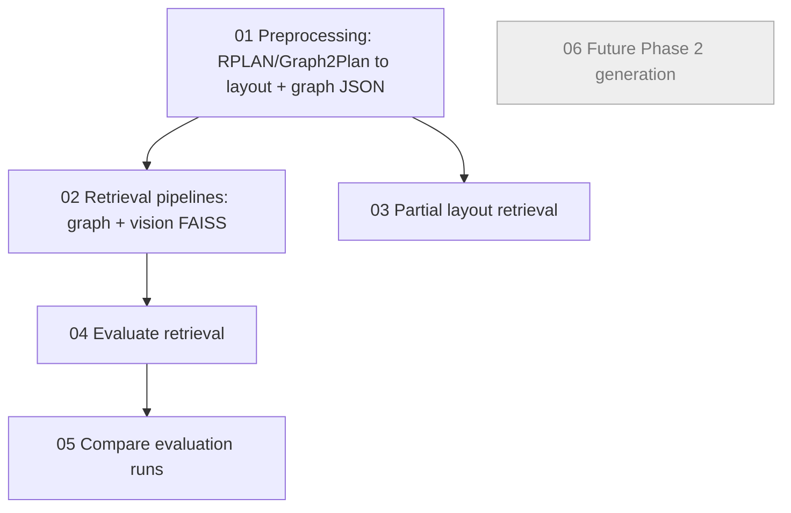

# Prism Phase 1 — prism-cluster

This project implements the current CVCS Phase 1 scope: **Vision vs Graph Representations for Semantic Architectural Search**. It is retrieval-only: preprocessing RPLAN/Graph2Plan data, building graph and vision FAISS retrieval pipelines, evaluating semantic/structural metrics, comparing encoders, and running partial layout retrieval.

## Pipeline dependency diagram



Important: stage 03 branches directly from stage 01. It does **not** depend on stage 02.

## Repository structure

```text
config/       YAML configs for each stage, room zones, and scale policy
scripts/      numbered Python stages + setup/wrapper scripts
src/          shared helpers copied into both local and cluster projects
data/         ignored; raw and processed datasets live here
outputs/      ignored; stage outputs live here
docs/         documentation
```

## Quickstart

Use SLURM jobs in `jobs/*.sbatch`. The default configs preserve the existing paths: `data/processed/rplan/...` and `outputs/...` locally, and `/work/cvcs2026/PrismTeam/...` on the cluster.

See `docs/dataset.md` for the implemented schema, area fields, zone taxonomy, and door/window feasibility findings.
