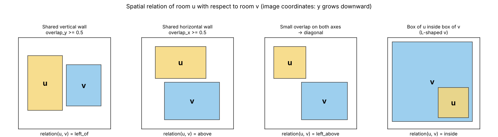

# Adjacency, spatial relations and front door

This page explains how phase 03 builds the graph of a floor plan, and why the
relations differ from the ones in the previous code.

## What was there before

Pier's preprocessing copied the third column of `sample.edge` from the
Graph2Plan pickle and gave it a name (`0 = left-above`, `1 = left-below`, ...).
There are three problems with that:

1. Graph2Plan's own code (`Interface/model/floorplan.py`, `get_triples`)
   **ignores** that column and recomputes the relation from the room boxes.
   So we cannot be sure what the stored value means.
2. The Graph2Plan paper says the direction of each edge is **sampled at
   random** ("for each pair of adjacent rooms, we randomly sample one
   direction"). The same pair of rooms can therefore appear as "A left of B" or
   "B right of A" for no reason.
3. Two versions of the old code used two different id-to-name tables.

Phase 01 prints the histogram of that column, and phase 03 compares it with
our relations (table "Graph2Plan raw third column vs our relation"). If the
column encoded our relation, every row of the table would sit in a single
column.

## Adjacency (does an edge exist?)

Graph2Plan connects two rooms if they share an interior door or are closer
than a threshold. We have no interior doors in the pickle, so we use geometry
only:

1. Each room polygon (`rBoundary`) is drawn into a 256x256 mask.
2. Each mask is dilated by `geometry.wall_dilation_px` (default 3 px), so masks
   of rooms on the two sides of a wall overlap.
3. Shared-wall length = longest side of the overlap region minus `2 x dilation`.
4. Adjacent if the shared wall is at least `geometry.min_contact_px` (default
   5 px). Rooms that touch only at a corner have length ~0, so they are **not**
   adjacent.

The phase-03 preview report shows precision and recall against Graph2Plan's
edge list for several dilation radii, so you can pick the value that fits
RPLAN's wall thickness. `geometry.adjacency_source` can also be `g2p` (use
Graph2Plan's pairs) or `union`.

## Spatial relation (what kind of edge?)

`relation(u, v)` = position of room **u** relative to room **v**, in image
coordinates (y grows downward, so *above* means smaller y). It is computed
from the bounding boxes, in this order:

1. **Containment.** At least 90% (`containment_threshold`) of u's box lies
   inside v's box → `inside`. The opposite case → `surrounding`. This happens for
   rooms nested in the bend of an L-shaped living room.
2. **Axis overlap.** `ox` = overlap of the x-intervals ÷ the narrower width;
   `oy` the same for y.
   - `ox ≥ 0.5` (`axis_overlap_threshold`): the rooms are stacked and share a
     horizontal wall → `above` / `below`.
   - `oy ≥ 0.5`: side by side, sharing a vertical wall → `left_of` / `right_of`.
   - both: the axis with the larger normalised centroid offset wins.
3. **Diagonal.** Otherwise: `left_above`, `right_above`, `left_below` or
   `right_below`, from the signs of the centroid offset.

Every adjacency is stored **twice**, `u→v` with `r` and `v→u` with the inverse
of `r` (left_of ↔ right_of, above ↔ below, left_above ↔ right_below, inside ↔
surrounding). Nothing is random. Each edge also carries continuous attributes
(`dx`, `dy`, `overlap_x`, `overlap_y`, `shared_wall_px`) that the GNN uses as
edge features, so it does not depend only on the discrete label.

## Front door

**RPLAN / Graph2Plan.** The front door is the segment between the first two
points of `sample.boundary`, which is how Graph2Plan itself reads it
(`door = boundary[:2, :2]`). In the original images it is the yellow line on
the exterior wall. Phase 01 draws this segment over the snapshots and measures
its distance from the yellow pixels, as an automatic check.

**ResPlan.** A separate `front_door` polygon, collapsed into a segment along
its long axis.

How it is represented everywhere:

| Where | What |
|---|---|
| layout JSON | `front_door`: segment, centre, width, orientation, **facing** (north/south/east/west: the side of the building it opens to), **entrance_room_id**; `is_entrance_room` on the room |
| graph JSON | a virtual node `FrontDoor` (type `front_door`) linked to the entrance room by an edge with `connection = "entrance"` and a spatial relation; `door_hops` (graph distance from the entrance room) and `door_distance` on every room node |
| GNN features | one-hot FrontDoor type, `is_entrance_room`, `door_hops`, `door_distance`; connection one-hot on edges |
| descriptor | door position, width, facing, entrance-room type, hop statistics |
| renders | thick yellow segment on the exterior wall |
| partial retrieval | the door is never removed; re-ranking rewards the same entrance-room type and facing |
| evaluation | `door_entrance_type_match`, `door_facing_match`, `door_score` |

## Connection types (RPLAN + ResPlan)

`edge.connection` ∈ {`wall`, `door`, `arch`, `entrance`, `unknown`}. RPLAN only
gives `wall` (adjacent across a wall, door unknown). ResPlan's graph
distinguishes `door`, `arch` and `wall`, and these are copied when the ResPlan
adapter is used. This way the two datasets share one edge schema.
